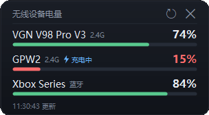

# BatteryWidget

一个常驻桌面的轻量无线设备电量悬浮窗，面向 Windows 10。当前适配：

- VGN V98 Pro V3 键盘（优先 2.4G，不可用时回退蓝牙）
- Logitech GPW2 鼠标（Lightspeed 2.4G）
- Xbox Series 手柄（蓝牙）

只做三件事：显示电量、低电量变色提醒、在需要时刷新。不联网、无遥测。



## 功能

- 按当前连接设备动态显示电量行（最多三行），电池条 + 百分比
- 设备断开或手柄休眠时自动移除对应行，窗口高度随之收缩；无设备时显示“暂未识别设备连接”
- 低电量变色：≤ 30% 橙色，≤ 15% 红色（阈值可配置）
- 充电状态：蓝色闪电 + “充电中”，充满显示“已充满”
- 设备无响应或读取失败时，沿用上次成功读数并标记 `≈`
- 前台全屏时自动隐藏并暂停键鼠查询；全屏期间每 180 秒只检查一次手柄
- 桌面可见时默认每 60 秒刷新；检测到近期有键鼠输入时加速刷新
- 插拔设备或 GPW2 充电状态变化时立即刷新（1.5 秒防抖，全屏时忽略）
- 可拖动；拖到左 / 右 / 上边缘自动吸附并隐藏为细条，鼠标靠近唤出，拖离取消
- 顶部刷新 / 关闭按钮，右键菜单“立即刷新 / 退出”
- 单实例运行；窗口位置、停靠状态自动保存

## 系统要求

- Windows 10（64 位实测；需要支持 Win10 的 .NET Framework 4.8，1903 及以后版本通常已自带）
- 无需管理员权限，无需安装

## 使用

### 下载运行

1. 从 [Releases](https://github.com/biin95/battery-widget/releases) 下载 `BatteryWidget.exe`，或下载 `BatteryWidget-v1.1.0.zip` 后解压。
2. 放到任意固定目录（之后不要随意移动，否则开机自启快捷方式会失效）。
3. 双击运行。程序未签名，SmartScreen 可能提示“Windows 已保护你的电脑”，点击“更多信息 → 仍要运行”。

首次运行会在 `%APPDATA%\BatteryWidget` 生成 `config.ini` 和 `widget.log`。

### 交互

| 操作 | 效果 |
| --- | --- |
| 左键拖动窗口 | 移动位置 |
| 拖到屏幕左 / 右 / 上边缘 | 吸附并自动隐藏；鼠标移入边缘细条唤出 |
| 从停靠状态拖离边缘 | 取消自动隐藏 |
| 点击右上角 ⟳ | 立即刷新 |
| 点击右上角 × | 退出 |
| 右键 | 菜单：立即刷新 / 退出 |

### 开机自启

1. `Win + R` 输入 `shell:startup` 回车，打开“启动”文件夹。
2. 为 `BatteryWidget.exe` 创建快捷方式，放入该文件夹。
3. 如果之后移动了 exe，需要同步更新快捷方式。

## 配置

配置文件：`%APPDATA%\BatteryWidget\config.ini`。修改后重启程序生效；窗口位置和停靠状态会在拖动、退出时自动写回。

| 键 | 默认值 | 说明 |
| --- | --- | --- |
| `RefreshSeconds` | 60 | 桌面可见时的刷新间隔，范围 5–3600 秒 |
| `WarnPercent` | 30 | 橙色提醒阈值 |
| `CriticalPercent` | 15 | 红色提醒阈值，需小于 `WarnPercent` |
| `WindowX` / `WindowY` | 自动 | 上次窗口坐标，自动维护 |
| `Dock` | none | 停靠边：`none` / `left` / `right` / `top`，自动维护 |

## 刷新策略

- 窗口可见且前台不是全屏程序时，按 `RefreshSeconds` 定时刷新。
- 检测到最近 3 秒内有键鼠输入，且距上次刷新超过 `max(15, RefreshSeconds / 2)` 秒时，提前刷新。
- 前台进入全屏（游戏、全屏视频等）时隐藏窗口，暂停键盘 / 鼠标查询；全屏期间每 180 秒仅查询一次手柄。
- 退出全屏后立即显示并刷新。
- 收到系统设备变化广播，或 GPW2 上报充电状态变化时，1.5 秒防抖后立即刷新。
- 短暂读取失败沿用上次成功读数并标记 `≈ 上次读数`；持续无响应约 90 秒后按断开处理，移除对应行。
- 设备断开（蓝牙关闭、接收器拔出、手柄关机等）后移除对应行，窗口高度自动收缩；没有设备时显示“暂未识别设备连接”。
- 手柄休眠后 Windows 仍会保留其蓝牙电量属性，因此在线状态以 XInput 为准：休眠或关机时按断开处理并移除该行，唤醒后自动恢复。

## 支持的设备

| 设备 | 连接 | 读取方式 |
| --- | --- | --- |
| VGN V98 Pro V3 | 2.4G | 厂商 HID 报文（VID `0x258A`，接收器 PID `0x024F`，Report ID `0x13`）；失败时回退蓝牙 PnP 电量 |
| Logitech GPW2 | Lightspeed 2.4G | HID++ 2.0 统一电量特性 `0x1004` 的 getStatus（VID `0x046D`，接收器 PID `0xC547`） |
| Xbox Series 手柄 | 蓝牙 | Windows PnP 电池属性（名称含 `xbox` 或 PID `0x0B13`），XInput 判断是否在线 |

设备识别和协议按上述型号实现，其他型号默认不适配；可参照 `src/Providers/` 增加支持。

### 已知限制

- 键鼠必须使用 2.4G 接收器；有线模式不读取。
- 鼠标休眠或无响应时先沿用缓存值；持续无响应约 90 秒后按断开处理并移除该行。
- VGN 键盘仅在 2.4G 读取失败时回退蓝牙，两个通道的电量可能略有差异。
- 蓝牙模式只暴露标准电池服务（电量），不提供充电状态；键盘切到蓝牙后只能显示电量。2.4G 模式可显示充电状态。
- 蓝牙电量依赖 Windows 上报，切换连接方式或开始充电后可能有延迟。
- 未做数字签名，首次运行可能触发 SmartScreen 提示。
- 协议基于实测逆向，设备固件升级后可能失效。

## 构建

环境：Windows + .NET Framework 4.x（使用系统自带 `csc.exe`），无第三方依赖。

```bat
build.cmd
```

输出 `build\BatteryWidget.exe`。编译清单在 `build\app.rsp`，应用清单为 `src\app.manifest`。

<details>
<summary>目录结构</summary>

```
src/
  Program.cs              入口、单实例
  WidgetForm.cs           窗口绘制、拖动、停靠、刷新调度
  BatteryService.cs       后台读取与缓存
  Config.cs / Logger.cs   配置与日志
  FullscreenDetector.cs   全屏检测
  Interop/                Win32、HID、PnP 封装
  Providers/              三个设备各自的电量读取
tools/
  Preview/                离屏渲染界面预览图
  Probe/                  硬件诊断工具
  Test/                   拖动、停靠、前台检测测试工具
build.cmd                 一键构建
build/app.rsp             csc 编译清单
```
</details>

## 日志与隐私

- 程序不联网、不上传任何数据，没有遥测。
- 配置和日志仅保存在 `%APPDATA%\BatteryWidget`。
- 正常运行时日志记录设备名称、电量和刷新结果，不包含蓝牙设备实例 ID；异常信息可能包含本地路径。公开日志前请自行检查。
- 日志超过 512 KB 自动轮转为 `widget.old.log`。

## 免责声明

本项目为个人使用的第三方小工具，与 VGN、Logitech、Microsoft 无关联。按现状提供，使用风险自负；设备协议可能随固件更新变化。
